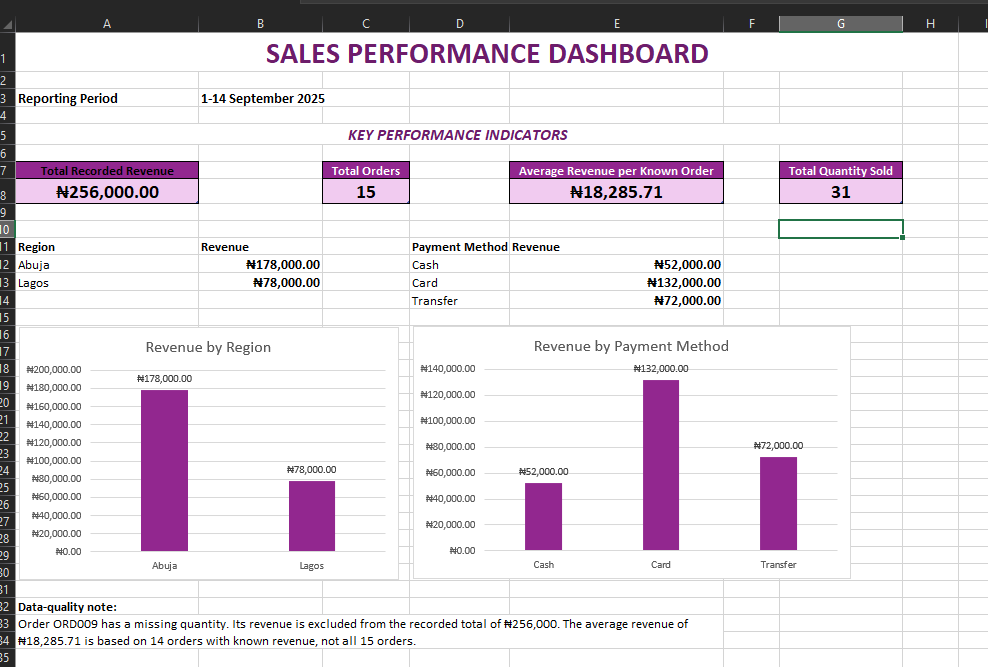

# Retail Sales Analysis Using Microsoft Excel

## Project Overview
## Dashboard Preview

This is my first practical data analytics project, completed as part of my journey toward becoming a Data Analyst, with a long-term interest in Engineering Data Analytics.

I used Microsoft Excel to clean, validate, analyse, and visualise a retail sales practice dataset. The project helped me practise turning raw data into meaningful findings while identifying data-quality limitations.

## Project Objectives

- Clean and prepare a raw sales dataset for analysis.
- Identify duplicate records and missing values.
- Use Excel formulas to calculate revenue and summarise sales.
- Analyse revenue by region, product, and payment method.
- Create KPIs and a sales performance dashboard.
- Apply data-quality checks and validation rules.
- Communicate findings and recommendations based on evidence.

## Tools and Skills

**Tool:** Microsoft Excel

**Skills practised:**
- Data cleaning and preparation
- Excel Tables and structured references
- IF, SUM, AVERAGE, COUNT, COUNTA, SUMIF, SUMIFS, COUNTIF, COUNTIFS and VLOOKUP
- Duplicate detection and missing-value checks
- Data validation
- PivotTables and PivotCharts
- KPI calculations
- Dashboard creation
- Data interpretation and reporting

## Analysis Process

1. **Clean:** Removed duplicate records and standardised inconsistent region and payment-method entries.
2. **Validate:** Checked for missing values, duplicate order IDs, and invalid payment methods.
3. **Analyse:** Used Excel formulas and PivotTables to summarise revenue by region, product, and payment method.
4. **Visualise:** Created KPI summaries, charts, and a sales performance dashboard.
5. **Interpret:** Identified key findings, documented limitations, and developed evidence-based recommendations.

## Key Findings

The cleaned practice dataset contained 15 unique orders.

- **Total recorded revenue:** ₦256,000
- **Orders with known revenue:** 14
- **Average recorded revenue per known order:** ₦18,285.71
- **Total recorded quantity sold:** 31 units
- **Highest-revenue region:** Abuja, with ₦178,000
- **Highest-revenue product:** Laptop Bag, with ₦75,000
- **Highest-revenue payment method:** Card, with ₦132,000, representing 51.56% of recorded revenue

## Data Quality and Limitations

One order, ORD009, had a missing quantity. Its revenue could not be calculated and was excluded from the recorded revenue total and average.

Therefore, ₦256,000 represents the recorded revenue from orders with known quantities, not necessarily the final revenue for all 15 orders.

Revenue alone does not show profitability. Further analysis would require cost data.

## Recommendations and Next Steps

- Investigate regional performance: Abuja generated ₦178,000 in recorded revenue compared with ₦78,000 in Lagos. Compare order counts, average order values, customer demand, and relevant costs before deciding where additional investment may be most effective.
- Investigate the missing quantity for ORD009 before finalising the sales figures.
- Analyse product costs and profit margins to identify the most profitable products.
- Examine average order value by payment method before drawing conclusions about customer purchasing behaviour.
- Continue developing my skills in SQL, Power BI, Python, and data analytics for engineering and construction applications.

## Project Files

- [Excel Sales Analysis Workbook](excel-sales-analysis.xlsx) — Contains the practice dataset, cleaning checks, formulas, PivotTables, KPI analysis, and dashboard.
- [View the Project Repository]([https://github.com/](https://github.com/princessnbernard/excel-sales-analysis/tree/main)) — Explore the project files and documentation.

## What I Learned

This project taught me that data analysis is not just about calculating numbers or creating charts. It also involves checking data quality, recognising limitations, and making sure that conclusions are supported by evidence.

This is an ongoing learning project, and I will continue improving it as I develop my analytical skills.
